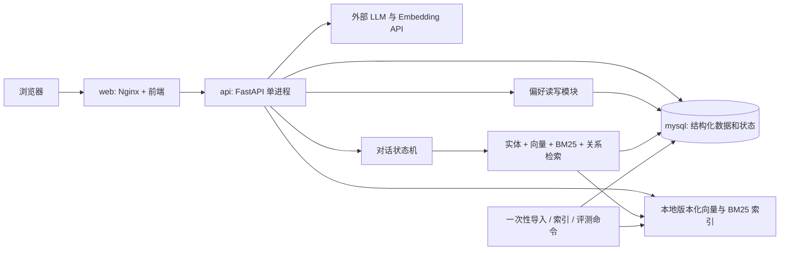

# 整体架构与六模块设计

状态：设计草案，待确认后开发。规模假设：50—100 个首批景点、数千至数万文本片段、少量演示用户、单机 Docker Compose。先实现全部六项功能，再基于统一评测调优；功能开关用于实验对比，不用于缩减最终范围。

## 1. 技术决策

| 层 | 默认方案 | 职责与理由 |
| --- | --- | --- |
| 前端 | 沿用已有源码；无源码时 React + Vite + TypeScript | 聊天、地图、景点卡片、停止/纠正、记忆管理 |
| Web 入口 | Nginx，与静态前端放在同一容器 | 静态文件、同源 `/api/` 反向代理、SSE 透传 |
| 后端 | Python 3.12、FastAPI、Pydantic、SQLAlchemy、Alembic | 接口校验、业务流程、数据库访问与迁移 |
| 主数据库 | MySQL 8.4 系列，InnoDB、utf8mb4 | 景点、实体关系、资料、会话、任务、用户偏好 |
| 向量检索 | 后端 NumPy 精确余弦检索 | 小规模数据直接计算，避免新增向量库服务 |
| 关键词检索 | 后端 BM25，例如 rank-bm25 | 与向量检索并行；中文分词和繁简规范化统一处理 |
| 关系检索 | MySQL 实体表、关系表、限定 SQL JOIN | 按地区、主题、站点等关系查找，一至两跳 |
| 对话编排 | 显式状态机 + 类型化工具接口 | 单 Agent 受控执行，限制循环和工具次数 |
| LLM / Embedding | 后端适配器调用外部模型 API | 模型名称、向量维度、超时和配额配置化 |
| 测试与评测 | pytest、前端交互测试、JSONL 评测脚本 | 分开评估确定性规则与模型回答质量 |

默认只有 MySQL 一个数据库中间件。Redis、Neo4j、Elasticsearch、Qdrant、消息队列和 Kubernetes 均不进入首版部署。后端单进程多异步任务；数据导入和评测复用同一后端镜像，按命令运行一次性任务。向量规模超出内存和延迟预算后，再通过检索接口替换为专用索引服务。

向量为归一化 float32 矩阵，约 N×D×4 字节；例如 10,000×1,024 约 39 MiB，仅表示矩阵本身，未包含文本、BM25、运行时和查询开销。实际延迟需要在目标机器测量。查询与资料必须使用相同 Embedding 模型及版本；更换模型需重建索引。

## 2. 逻辑与容器结构

图中 Memory、Agent、Retrieval 是后端内部模块，不是独立容器。地图由前端地图组件展示 WGS84 坐标；地图底图供应方及使用条款在实现时确定。图片是景点展示资源；本次图检索指实体关系检索，不包含图片相似度搜索。

建议后端目录：`app/api/`、`core/`、`models/`、`repositories/`、`services/`、`rag/ingestion/`、`rag/retrieval/`、`rag/generation/`、`agent/`、`memory/`、`evaluation/`。保留仓库现有分层，新增模块按职责接入。

## 3. 模块一：结构化知识库

以稳定 `entity_id` 关联景点、中英文名、别名、地区、主题、站点和适合人群。景点详情存坐标、地址、简介、故事、预算和游玩时长；资料来源、图片和文本片段分表。每项可陈述事实可追溯来源；缺失数据保留 NULL，缺少票价不解释为免费。

数据流水线：来源登记 → 获取原文 → 标准化和去重 → 实体及关系审核 → 文本切分 → 生成向量和 BM25 → 构建新索引版本 → 验证后激活。导入以稳定 ID 和内容哈希幂等处理。历史故事保留依据；开放时间和票价带核对时间。

交付：数据模型、迁移、导入校验、详情/筛选接口、景点卡片和地图。数据定义见 `data/DATA_DICTIONARY.md`。

## 4. 模块二：混合与轻量图检索

执行流程：

1. 中英名称与别名匹配；繁简转换只用于检索规范化，保留原文展示。
2. 提取地区、主题、室内外、预算等显式约束，形成类型化过滤条件。
3. 并行取得向量 Top-20、BM25 Top-20，按问题需要取得实体/关系候选。
4. 检索前应用可用过滤条件；采用后过滤时，扩大候选或在满足条件子集重新检索，避免全局 Top-K 被过滤后漏召回。
5. 用加权 RRF 融合排名，起始各通道等权；形式为 `sum(w_i / (60 + rank_i))`。rank 从 1 开始；缺席某通道贡献 0。调参只使用开发集。
6. 去重并限制每个景点片段数，返回 Top-5 至 Top-8 证据；关系路径和来源随结果返回。

MySQL 关系例子：景点 → `LOCATED_IN` → 地区；景点 → `HAS_THEME` → 主题；景点 → `NEAR_STATION` → 站点。先实体消歧，再使用固定 SQL 模板 JOIN；不执行模型生成的任意 SQL。关系表增加起点/终点及关系类型索引，最多两跳、限制候选数量。

“同地区且具有历史主题”可通过关系求交集。只有资料或计算支持的关系才入库。距离近使用 WGS84 坐标计算直线距离；同地区不等于附近，直线距离不等于步行时间。若两个候选别名相同且无法消歧，则追问。

硬条件先保证，个性化偏好只调整合格候选排序；不得把“符合旧偏好”排在“满足本次明确条件”之前。向量与 BM25 都是已实现通道；评测支持单独关闭，以比较向量、BM25、混合、混合加关系的差别。

## 5. 模块三：Agentic RAG

状态流程：读取当前有效会话 → 提取意图/约束 → 按需澄清 → 选择工具 → 整理证据 → 生成带引用的回答 → 校验结果 → 完成。

简单事实走一次检索；比较问题分别检索对象；复杂问题最多拆为 3 个子问题。首版每任务最多 6 次工具调用、总执行预算起始 60 秒、可重试错误最多重试 1 次，具体值由实测配置。工具只包含景点详情、混合检索、关系查找、距离计算和本人偏好读取。支持多轮指代和约束更新；不要求模型输出内部推理过程，调试记录只保存工具输入输出、证据 ID、延迟和错误。

回答返回文本、引用、景点 ID、数据核对时间及必要限制。知识不足时说明缺口；资料中的指令不作为系统指令。行程第一版提供符合已知条件的游览顺序建议；交通时间、实时票价、实时营业或预约可用性在没有数据时不承诺。

## 6. 模块四：可打断、纠正和暂停

每个任务有 `run_id`，每个会话有当前有效任务；单会话同一时刻只允许一个有效生成。状态为 queued/running/cancelling/completed/cancelled/failed/interrupted。终态不可被迟到任务改写。

文字停止：前端调用取消接口，后端标记取消令牌并中止本地协程，在模型支持时关闭上游流。第三方服务可能已产生费用，不能承诺远端立即停止。即使远端不能取消，也丢弃旧结果。

文字纠正：先取消旧任务，增加会话版本，按最新约束启动新任务。事件携带 run_id 和递增 seq；前端只接收当前有效任务。提交答案和偏好前，数据库事务锁定会话并检查任务、版本和取消状态，防止旧任务写入。

暂停分两种：流式生成中暂停表现为结束当前生成，继续时基于保留上下文创建新任务；在澄清节点等待用户输入则将会话设为 awaiting_input 并保存 checkpoint。第一版不承诺在任意一个 Token 位置冻结并原地恢复第三方推理。

Hook 负责在 before_tool、after_tool、before_generate、before_commit 检查取消/预算/版本；它与前后端取消协议共同实现交互。浏览器断线后执行有界清理；API 重启把未终结任务置为 interrupted，允许用户重试。首版不自动恢复半途生成。

## 7. 模块五：长期记忆

MySQL 保存显式偏好及来源消息；会话临时约束单独保存。优先级：本轮明确要求 > 本次会话约束 > 有效长期偏好 > 默认值。只记录明确表达并允许保存的偏好，模型推测作为候选供用户确认。

支持启用/停用、查看、编辑、删除记忆。偏好按用户 + key 保留一条当前记录，更新保留来源和时间；删除清空偏好值及检索使用，来源消息本身若仍保留不能触发自动重建。未来提取只处理新消息，重新记录需要新授权。写入仅来自有效未取消任务或用户显式编辑操作。

Demo 使用服务端签发的随机访客凭证，数据库只存哈希；同浏览器跨会话可用，跨设备需要额外登录方案。服务端从凭证确定 user_id，禁止客户端任填 user_id 访问资料。所有会话、任务和偏好接口校验归属。长期记忆不是模型训练。

## 8. 模块六：评测与观测

先整理 100 条人工核对样本，按场景分层划分开发/保留测试集；同一问题的改写归为同一 group，避免泄漏。范围包含事实、名称/语言、筛选、关系、多轮、无答案、纠正、记忆和异常。

检索指标：Recall@5（以相关 chunk ID 为单位）、MRR（首个相关结果排名倒数）；景点级召回单独报告。问答指标：事实正确、引用支持、约束满足、无依据陈述；交互指标：TTFT、总时长、取消后仍收到旧事件数；成本指标：工具次数、Token 与调用费用。LLM 评分需人工抽查，报告评分规则。

每次实验固定数据快照、索引版本、模型标识、提示词版本、代码版本、检索权重与开关。保存逐样本结果，不仅保存均值。若外部服务不提供不可变模型版本，明确报告可复现限制。详细用例和验收见开发测试计划。

## 9. API 草案（均未实现）

公共前缀 `/api/v1`，JSON 字段 snake_case；错误体包含 code/message/request_id，错误不泄露凭证。

| 方法和路径 | 用途 |
| --- | --- |
| POST `/auth/guest` | 创建访客凭证，通过 HttpOnly Cookie 使用 |
| GET `/attractions`、`/attractions/{id}` | 筛选、分页、详情、地图字段 |
| POST `/search` | 返回片段、景点、引用和关系路径 |
| POST `/sessions`、GET `/sessions/{id}` | 创建/恢复本人会话 |
| POST `/sessions/{id}/runs` | 提交消息和幂等 request_id，返回 run_id |
| GET `/runs/{id}/events` | SSE：status/token/citation/done/error/cancelled |
| GET `/runs/{id}` | 查询状态及已持久化结果 |
| POST `/runs/{id}/cancel` | 幂等取消，终态返回实际终态 |
| GET/PATCH `/me/preferences` | 查看/更新本人偏好和记忆开关 |
| DELETE `/me/preferences/{key}` | 删除偏好并保留禁止旧消息重提取的状态 |
| GET `/health/live`、`/health/ready` | 进程存活与数据库/索引就绪 |

POST 创建任务时预建有界事件缓冲，避免订阅前丢事件；SSE 连接检查任务归属。首版仅支持当前连接的实时流，断线用状态接口恢复最终或部分结果，明确提示 interrupted，不承诺 SSE 自动逐 Token 补发。请求重试用 request_id 幂等，不启动重复任务。Cookie 请求同源，校验 Origin 并设计 CSRF 防护。

## 10. 技术依据

- [MySQL CTE / SQL 关系查询](https://dev.mysql.com/doc/refman/8.4/en/with.html)：本设计使用限定 JOIN，一至两跳无需专用图数据库。
- [MySQL Unicode](https://dev.mysql.com/doc/refman/8.4/en/charset-unicode-sets.html)：采用 utf8mb4 存储中英文与扩展字符。
- [向量相似度计算](https://www.sbert.net/docs/sentence_transformer/usage/semantic_textual_similarity.html)：本地归一化向量按余弦排序。
- [LangGraph interrupts](https://docs.langchain.com/oss/python/langgraph/interrupts)：等待外部输入的暂停与用户取消生成需要区分；首版可自行实现状态机。

以上为设计选择，性能收益和回答质量仍需实测。
