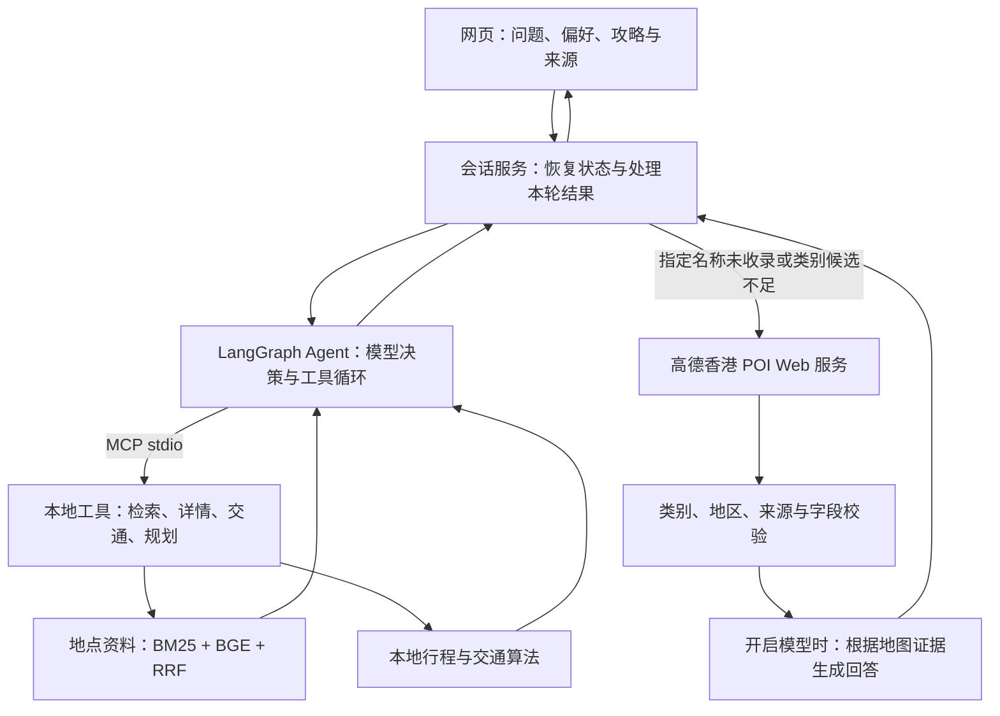

# 港慢游 · Hong Kong, your way

**DSAI5205 Introduction to Artificial Intelligence · 香港旅行问答与行程规划**

课程演示说明更新：2026-10-28。

我们实现了一个结合 **RAG（检索增强生成）、MCP（模型上下文协议）和地图补充检索**的香港旅行助手。系统通过网页接受自然语言问题，从附官方来源的地点资料中检索证据，按需补充高德地点信息，再由云端大模型生成带出处的回答。用户还可以选择地点、生成逐日攻略，并在同一段对话中调整旅行天数、地点和游览节奏。

项目采用无需训练或微调大模型的实现方式。**RAG 提供回答依据，MCP 提供本地工具接口，LangGraph 协调多轮任务，高德地图补充地点证据；行程排程由本地算法完成。**


## 1. 项目问题与课程定位

面向初次到访香港、需要结合地区与出行偏好安排旅程的用户，项目处理三个问题：

- **信息有依据**：地点介绍可以查看资料来源；对没有证据的信息明确说明限制。
- **规划可继续修改**：记住旅行条件和已有行程，支持“再多加一天”“把这个地点换掉”等追问。
- **知识覆盖可补充**：本地缺少指定地点或足够的同类候选时，按香港范围查询地图资料。

本项目用于 **DSAI5205**。根据课程 Final Project Guidance，项目需展示一个可交互、采用 training-free 策略的 LLM 应用，并正确使用至少一种现代 LLM 技术。本文按课程要求的问题、方法、实现、演示、收益与局限组织；README 用于理解和复现系统，课程幻灯片与不超过 10 页正文的报告仍需另行准备。

| 课程关注点 | 本项目的对应内容 |
| --- | --- |
| 实际问题与用户场景 | 香港地点咨询、推荐与多轮行程调整 |
| LLM 技术及设计理由 | RAG 提供外部证据；MCP 统一工具访问；LangGraph 协调状态与调用 |
| 可运行系统 | FastAPI 后端、原生网页、本机启动与 Render 演示入口 |
| 正确性与边界 | 来源引用、类别筛选、状态校验、调用上限、失败状态与回归测试 |
| 讨论与改进 | 小知识库覆盖、模型错误、外部服务依赖及评估限制 |

课程不要求大型对比实验，但要求解释设计为何合适、系统为何能正确工作。本项目以 RAG 和 MCP 为主要技术展示内容。

## 2. RAG、MCP 与地图分别做什么

| 组成 | 在本项目中的作用 | 实现位置 |
| --- | --- | --- |
| **RAG** | 检索相关资料、筛选证据、提供给模型生成回答并展示引用 | `travel/retrieval.py`、`travel/embeddings.py`、`travel/agent.py`、`travel/map_rag.py` |
| **MCP** | 用标准协议调用本地检索、地点详情、交通估算和行程规划工具 | `travel/mcp_server.py`、`travel/mcp_client.py` |
| **LangGraph Agent** | 维护结构化旅行条件、有界上下文及最新行程，协调模型决策与工具调用 | `travel/agent.py`、`travel/conversation_memory.py` |
| **高德地图 Web 服务** | 提供香港 POI 名称、地址、类别、位置，以及独立的步行路线参考 | `travel/maps.py`、`travel/map_rag.py` |
| **本地规划算法** | 按约束筛选、街区分组和近邻排序生成逐日攻略 | `travel/planner.py`、`travel/itinerary_edits.py` |

例如，用户问“中环有什么文化景点”，Agent 通过 MCP 调用检索工具，模型再依据返回的资料回答，这一过程体现 RAG。用户要求“把这些地方安排成三天行程”，Agent 通过 MCP 调用规划工具，具体排程由本地算法完成。高德补充目前直接调用 Web 服务 API，不要求经过 MCP。

### 系统结构



不开启模型时使用本地规则、检索摘录与规划；地图候选可以直接展示。完整的“检索资料交给大模型生成回答”需要配置并开启模型。

### 本地知识库 RAG

1. `data/places.json` 保存 **33 条附官方来源的香港地点记录**。一条地点记录对应一个知识单元，包含名称、别名、地区、标签、简介、提示及来源。
2. SQLite FTS5 BM25 做关键词检索；可选的本地 `BAAI/bge-small-zh-v1.5` 通过 FastEmbed / ONNX 在 CPU 上生成 512 维向量，用精确余弦检索寻找语义相关资料。
3. 通过 RRF（倒数排名融合）融合两路排名，保留名称优先，并应用地区、室内条件和明确地点类别等筛选。
4. 将检索资料与有界会话上下文提供给云端模型；正文引用使用规范地点 ID，网页可打开对应出处。

当前使用结构化地点摘要，没有 PDF 自动摄取、长文切分或独立向量数据库。Embedding 模型或索引不可用时回退 BM25，并记录原因。相似度和排名分数不代表正确率，混合检索效果也需实验验证。

### 地图补充 RAG

- “K11在哪”按具体名称查询；“九龙有哪些商场”整理成 `香港 九龙 商场`。
- 本地未收录指定名称，或缺少足够的同类候选时，最多发起一次地图补充。类别推荐默认目标三个、查询目标最多五个，不承诺补满或列出香港全部地点。
- 商场问题不使用博物馆、购物街或商场内的停车场、餐厅充数；返回结果还需通过地区和来源等校验。
- 模型模式下，只将实际返回的名称、地址、类别与查询时间等有限字段提供给模型，回答使用 `[map-1]` 等本轮地图引用。
- 模型首次检索不到同类地点时提前转交地图层，避免重复搜索；纯检索触发重复调用或调用上限时，也可进入补充流程。规划冲突和总超时仍保持停止。

外部 POI 暂不自动加入本地知识库、向量索引或行程。详细流程见 [地图补充检索](docs/地图补充检索.md)。

### MCP 工具与多轮状态

| MCP 工具 | 功能 |
| --- | --- |
| `search_places` | 统一返回本地检索结果、匹配依据和检索元数据 |
| `place_detail` | 读取已检索规范地点的详情与来源 |
| `transfer_estimate` | 估算本地地点之间的交通余量并提供整理的交通参考 |
| `plan_itinerary` | 根据确认的日期、天数、地区、节奏与地点约束生成攻略 |

Agent 另有经服务端校验的会话工具 `update_trip`、`read_itinerary`、`revise_itinerary`；这些状态工具在进程内执行。结构化旅行条件和最新行程与原始聊天文字分开维护，上下文有长度边界，工具调用有重复保护和时限。

天数修改区分 **设置** 与 **增减**：已有三天行程时，说“再多加一天”得到四天，说“改成一天”得到一天；已有结束日期同步更新。未知原天数或调整后超出范围时要求澄清，模型误传参数会被后端校验拦截。

## 3. 本机运行与配置

### 快速启动

需要 Python 3.11+。在仓库根目录执行：

```sh
python3 start.py
```

首次启动创建 `.venv` 并安装锁定依赖，随后打开 <http://127.0.0.1:8765>。保留终端窗口，按 `Ctrl+C` 停止。macOS 也可双击 `启动港慢游.command`，Windows 可双击 `启动港慢游.bat`。

手动安装与启动：

```sh
python3 -m venv .venv
.venv/bin/python -m pip install -r requirements-lock.txt
.venv/bin/python run.py
```

端口占用时使用 `.venv/bin/python run.py --port 8767`，打开对应端口。Windows 将 `.venv/bin/python` 替换为 `.venv\Scripts\python.exe`。

### 云端生成模型与地图

参考根目录 `.env.example` 创建自己的 `.env`，填入本人平台凭据。不要提交真实 `.env`：

```dotenv
MODEL_API_KEY=
MODEL_BASE_URL=https://api-inference.modelscope.cn/v1
MODEL_NAME=deepseek-ai/DeepSeek-V4.1-Flash-1017
AMAP_API_KEY=
AMAP_ENABLED=false
```

- 没有 Key 可运行本地规则演示；配置模型并重启后，网页勾选“使用大模型”才会发起模型请求。
- 当前示例采用 ModelScope 的模型接口，需使用其访问令牌。模型地址、名称和 Key 需属于所选择的服务；见 [模型接入说明](docs/ModelScope模型接入.md)。
- 高德需要 **Web 服务** 类型 Key；启用时设置 `AMAP_ENABLED=true` 并重启。
- 模型模式会将问题、有界上下文、偏好及相关资料发送给配置的模型服务。服务权限、费用和可用额度以本人供应商账户为准。

### 本地 Embedding

课程展示混合检索前，在已有虚拟环境中执行一次：

```sh
.venv/bin/python -m pip install -r requirements-embedding.txt
.venv/bin/python scripts/build_embeddings.py --download
```

在根目录 `.env` 添加：

```dotenv
RETRIEVAL_MODE=hybrid
LOCAL_EMBEDDING_MODEL=BAAI/bge-small-zh-v1.5
EMBEDDING_MIN_SCORE=0.5
```

首次构建下载公开模型，正常查询只读取本机缓存。模型位于 `work/models/`，向量索引位于 `data/indexes/places-embeddings.json`，均由 Git 忽略；组员需各自准备。修改知识库或模型后需要重建索引。

不调用云端即可检查本地检索：

```sh
.venv/bin/python scripts/rag_demo.py --query "想了解香港历史建筑和艺术，有什么地方推荐？"
```

`retrieval.embedding_used=true` 表示本轮实际使用了向量检索；为 `false` 且有 `fallback_reason` 时应报告 BM25 回退。配置模型后可加 `--use-model` 验证云端生成，该操作会产生真实供应商用量。详见 [Embedding 接入说明](docs/Embedding接入说明.md)。

### 公网演示与历史模式

演示入口：<https://hk-travel-rag-demo.onrender.com>。网页行为取决于实际部署的提交和环境变量；本地修改需先上传 GitHub、合并到服务绑定分支，并等待 Render 部署为 **Live**。

| 运行模式 | 访问与历史行为 |
| --- | --- |
| 本机默认模式 | 监听回环地址；历史保存于忽略的 `work/user-data/conversations.sqlite3` |
| 公网密码模式 | 使用小组访问码；历史属于共享演示服务，不是个人账户 |
| 公网免登录模式 | 设置 `PUBLIC_DEMO_ANONYMOUS=true`；关闭共享历史接口，仅保留临时会话，刷新页面开始新对话 |

本机／密码模式最多保存 25 段对话、每段最近 20 轮。免登录会话保存在服务内存中，空闲约 30 分钟、服务重启或容量淘汰后失效；课堂连续修改应在同一页面完成。公网入口保留请求限流，不提供个人账号或跨设备历史同步。

`render.yaml` 是部署模板，默认关闭自动部署和免登录；已创建服务的控制台设置可能不同。启用自动部署时，确认绑定 `main` 并采用适合本仓库 CI 状态的触发方式。更多配置见 [公网演示部署](docs/公网演示部署.md)。

## 4. 课堂展示安排

课程展示总计 **18 分钟：14 分钟讲解与演示，4 分钟问答**，每位组员都应发言并能解释自己的工作。建议按以下顺序组织 14 分钟内容：

| 时间 | 内容 | 展示重点 |
| --- | --- | --- |
| 1 分钟 | 问题、用户与目标 | 为什么香港旅行需要可查来源、可调整的助手 |
| 3 分钟 | RAG、MCP 与选型理由 | 两条证据检索路径、工具协议与生成的区别 |
| 2 分钟 | 架构与实现 | 结构化状态、本地规划、来源与失败处理 |
| 5 分钟 | 交互演示 | 依次展示下表场景，打开必要执行记录 |
| 3 分钟 | 验证、收益与局限 | 展示已有证据、失败案例和改进方向 |

### 五分钟交互演示脚本

演示前确认模型配置、Embedding 索引和地图状态；使用本机或已部署服务，新建一段对话并开启模型。以下是演示目标，真实结果与耗时依赖模型、网络和地图覆盖。

| 顺序 | 操作／问题 | 应展示的内容 |
| --- | --- | --- |
| 1. 本地 RAG | “中环有什么文化景点？” | 回答与本地来源；展开“资料与执行记录”，查看 `search_places`、检索模式和 `embedding_used` |
| 2. 工具规划 | 选择“大馆、元创方 PMQ”，输入“请把已选地点安排成三天行程，节奏轻松，只安排这些” | 当前旅行条件与完整三天攻略；已选地点较少时保留自由活动日，指出排程由本地工具完成 |
| 3. 多轮修改 | 在同一页面继续输入“再多加一天”，然后“改成一天” | 总天数依次变为四天、一天，保留两处已选地点；换成更多地点导致容量不足时应要求调整，不应静默丢弃地点 |
| 4. 地图补充 | 清除地区／室内等额外限制，新建对话，问“九龙有哪些商场？” | 类别过滤、`map_search`、地图候选与来源；生成成功时展示 `[map-1]` 和 `map_rag_used=true` |
| 5. 能力边界 | “这些商场明天几点开门？” | 说明现有 POI 字段不能确认营业时间，不编造实时信息 |

可用“展开对话”增大阅读区域；执行记录仅展开关键一步，避免讲解被长 JSON 占满。免登录模式不演示刷新恢复、收藏或历史重开；这些功能应在本机／密码模式展示。步行小地图可作为补充演示，需确认同名地点或餐饮分店。

课程允许用短视频展示功能。建议在正式展示前保存一次实际运行的短录屏，作为外部服务或网络不可用时的备用，并说明录制的版本与条件。

### 报告与答辩要点

报告按课程结构准备：**Introduction、Method、Implementation、Demonstration、Discussion**，正文不超过 10 页，参考文献另计。课程评分为展示与演示 45%、报告 35%、幻灯片 20%；README 不替代这些交付物。

组员应能够解释：为什么使用 RAG；关键词与向量检索各自的作用；MCP 的具体工具和输入输出；地图与本地证据如何区分；相对天数如何校验；系统何时停止，以及没有资料时如何处理。按本人实际完成和理解的工作描述贡献，明确说明 GenAI 辅助的使用。

## 5. 验证方法与证据

2026-10-28 最近一次根目录回归结果为 **429 项 Python 测试通过**，覆盖相对天数修改、类别过滤、检索循环转交地图、引用、状态、访问模式等行为。根目录 `pytest.ini` 只运行 `tests/`，该数字不包括独立 `backend/` 应用的测试。

```sh
.venv/bin/python -m pip install -r requirements-dev.txt
.venv/bin/python -m pytest -q
```

综合检查可输出至本地忽略目录：

```sh
.venv/bin/python scripts/verify.py --out work/course-check
```

该脚本包含 Python 测试、数据校验、开发例题、本地 stdio MCP 与 Agent 验收；Node.js 可用时追加前端检查，否则记录未运行。普通回归使用空配置或模拟模型／地图响应，不发起真实云端请求。

| 证据类型 | 当前材料与用途 | 解释边界 |
| --- | --- | --- |
| 工程回归 | [`tests/test_intent_fixes.py`](tests/test_intent_fixes.py) 及其他 `tests/` | 检查预期行为和错误处理；测试数不等于问答准确率 |
| 检索检查 | `data/eval_cases.json` 22 道开发题、`data/holdout_cases.json` 20 道作者冻结检查题 | 小型手写数据，不能称为独立泛化评测 |
| 多轮界面 | [多轮网页验收](docs/evidence/floating-web-test/验收说明.md) | 历史版本的实际交互记录，不能证明全部新表述都正确 |
| 地图补充 RAG | [2026-10-27 脱敏验证](docs/evidence/map-rag-2026-10-27/summary.json) | 单例真实服务联调，不能保证当前可用性、准确率或固定延迟 |
| 云端服务 | [2026-10-28 云端验证](docs/evidence/public-demo-2026-10-28/summary.json) | 记录对应提交和当时的密码模式，不能替代最新部署验收 |
| 历史发布 | [2026-10-23 回归记录](docs/evidence/release-2026-10-23/summary.json) | 当时为 297 项 Python、17 项前端检查，不能作为当前数量 |

`scripts/evaluate.py` 检查开发题；`scripts/evaluate_holdout.py` 按冻结协议比较名称／别名匹配与原 BM25 基线，并保护首次输出，不是当前混合检索的完整对比评测。后续可在另行设计的固定测试集上比较纯模型、BM25 RAG、混合检索 RAG，记录检索相关性、回答依据、失败案例和耗时；尚未完成的实验不报告效果提升。

## 6. 当前局限与改进方向

- **知识覆盖有限**：33 条地点摘要不能代表香港全部景点、商场或餐饮。地图补充也受搜索结果、地区覆盖和字段限制影响。
- **语义与生成仍可能出错**：类别约束和引用编号校验能拦截部分错误，但不能证明回答每句话都正确；模型仍可能误解复杂追问或返回不合格格式。
- **实时信息不足**：未核验营业日历、票务、天气、排队、实时交通或完整费用预算。地图名称、地址和类别不能证明室内、免费等属性。
- **规划为启发式草案**：按条件、街区和顺序估算安排，不保证全局最优、最短路线或无障碍。外部 POI 暂不能自动纳入排程。
- **外部服务与演示环境有约束**：模型及地图存在延迟、配额与失败；Render 免费实例可能冷启动。系统不作为生产级多用户旅行服务。

下一步优先完善部署版演示验证、小型固定对比实验和知识覆盖；再根据用户体验改进页面。若扩展到长文知识库，需要另行设计资料摄取、分块、更新与检索评估流程。

## 7. 目录与协作入口

本 README 介绍的课程展示应用位于根目录 **`app.py`、`travel/`、`static/`**。仓库还保留另一套独立 Docker 演示，使用 `backend/`、`frontend/`、`compose.yaml` 和独立 `/api/v1/` 协议；运行 `python3 start.py` 不会启动该应用。

```text
app.py / run.py / start.py   课程展示应用、启动与安装入口
travel/                     Agent、MCP、RAG、会话、规划与地图服务
static/                     网页、地图组件与 Leaflet 依赖
data/                       地点、交通参考与检索检查题
tests/                      根目录 Python 与 Node 检查
scripts/                    索引构建、诊断、验证与源码打包
docs/                       根目录应用说明与验证证据
render.yaml                 公网部署模板
backend/ / frontend/        独立 Docker 演示应用
Doc/ / compose.yaml         独立 Docker 演示的文档与编排
```

接口见 [API 说明](docs/api.md)，协作见 [开发说明](docs/development.md)，独立 Docker 演示见 [运行指南](Doc/04-run-and-env.md)。`.github/CODEOWNERS` 与 GitHub 分支保护共同用于审核约束；创建文件本身不等于已经启用保护。

地点摘要保留来源与核对日期，不打包第三方全文；照片为界面装饰，不作为事实证据。Leaflet 保留原许可证和来源说明。真实 `.env`、模型缓存、向量索引和本机历史均不提交 GitHub。
