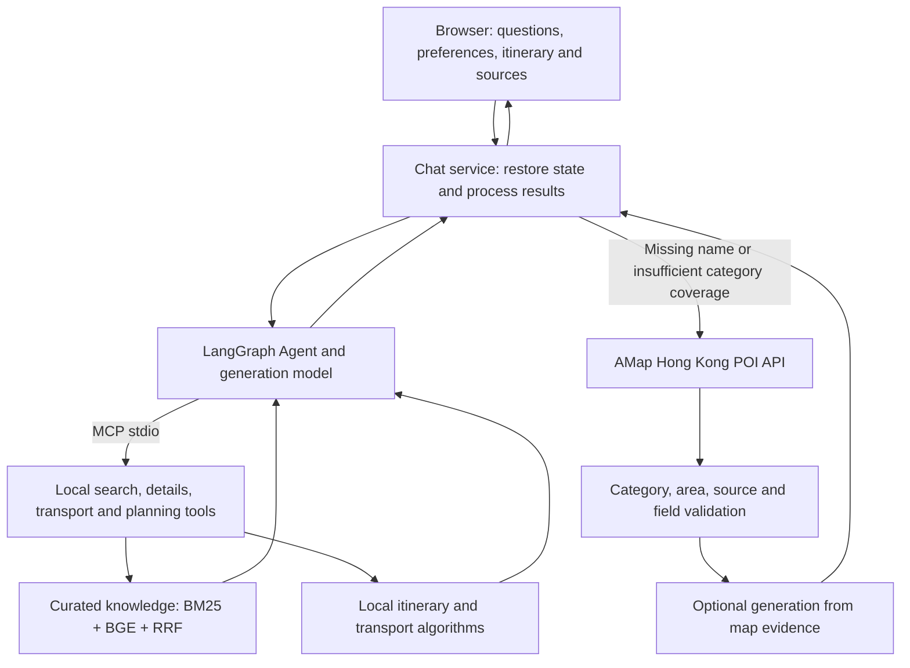

# HK Slow · Hong Kong, your way

**DSAI5205 Introduction to Artificial Intelligence · Hong Kong Travel Assistant**

English presentation edition · 29 October 2026.

We implemented an interactive Hong Kong travel assistant that combines **Retrieval-Augmented Generation (RAG)**, **Model Context Protocol (MCP)** tools and supplementary map retrieval. Users can ask about places, select destinations, create a day-by-day itinerary and refine it through conversation. The system retrieves source evidence before generating factual answers and shows citations that users can inspect.

The application uses **training-free strategies**: a local embedding model, a cloud generation model, tool orchestration and validated conversation state. RAG supplies evidence; MCP exposes local tools; LangGraph coordinates the workflow; AMap supplements place evidence; a local planning algorithm schedules the itinerary.

## 1. Problem and course alignment

The intended users are visitors who want a Hong Kong itinerary with traceable information and adjustable preferences. The project addresses three needs:

- **Source-backed answers:** connect place descriptions to official sources and acknowledge missing evidence.
- **Editable plans:** retain dates, selected places and preferences across follow-up requests.
- **Broader coverage:** supplement missing named places or insufficient category matches with Hong Kong map evidence.

This project is for **DSAI5205**. The course asks for an interactive LLM application using training-free strategies and at least one modern LLM technique. Our main techniques are RAG and MCP. The course does not require a large comparative experiment, but the group must explain why its design is appropriate and demonstrate correct behaviour.

| Course requirement | Project implementation |
| --- | --- |
| Practical problem and application scenario | Hong Kong place discovery and iterative itinerary planning |
| Correct use of an LLM technique | Source-grounded RAG and MCP tool access |
| Working interactive system | FastAPI backend, browser interface and deployment entry point |
| Explainable implementation | Source citations, execution traces, structured state and validated tools |
| Benefits and limitations | Traceable suggestions, bounded planning, explicit failures and limited coverage |

This README supports reproduction and explanation. The group must still submit the required slides and report and demonstrate understanding of its implementation.

## 2. What RAG, MCP and maps each do

| Component | Responsibility | Main files |
| --- | --- | --- |
| **RAG** | Retrieve and filter evidence, supply it to the generation model, and validate citation IDs | `travel/retrieval.py`, `travel/embeddings.py`, `travel/agent.py`, `travel/map_rag.py` |
| **MCP** | Expose local search, place details, transfer estimates and itinerary planning through a standard protocol | `travel/mcp_server.py`, `travel/mcp_client.py` |
| **LangGraph Agent** | Coordinate model decisions, tool calls, structured preferences and bounded conversation context | `travel/agent.py`, `travel/conversation_memory.py` |
| **AMap Web Service** | Retrieve Hong Kong place names, addresses, categories, positions and separate walking-route references | `travel/maps.py`, `travel/map_rag.py` |
| **Local planner** | Apply constraints, group stops by neighbourhood and order visits using a heuristic | `travel/planner.py`, `travel/itinerary_edits.py` |

For “What cultural places can I visit in Central?”, the Agent calls the retrieval tool through MCP and uses returned evidence to answer with citations. For “Plan these places over three days”, it calls the itinerary tool, whose local algorithm performs the scheduling. Supplementary AMap searches use the Web Service API directly; map access does not have to pass through MCP.

### Architecture



**Smart Assist** enables the cloud model. With it off, the application uses local rules, source extracts and planning tools; map candidates can still be displayed. The English browser explicitly requests English answers while keeping canonical tool values compatible with existing data.

### Local knowledge RAG

1. `data/places.json` contains **33 Hong Kong place records with official source links**. Each record is one knowledge unit: names, aliases, area, tags, description, visiting notes and provenance.
2. SQLite FTS5 BM25 performs keyword retrieval. Optional local `BAAI/bge-small-zh-v1.5`, through FastEmbed / ONNX on CPU, produces 512-dimensional embeddings for exact cosine retrieval.
3. Reciprocal Rank Fusion (RRF) combines rankings, with name priority and area, indoor and category filters.
4. The cloud model receives retrieved evidence and bounded context. Answers cite canonical place IDs, which the interface links to source details.

`data/places.en.json` provides English display names, descriptions and visiting notes for all 33 records. English query expansion bridges common English area and interest terms to the existing bilingual source index. Canonical records, source links, identifiers and original-language evidence are retained.

This is a structured-record knowledge base: it does not automatically ingest PDFs or split long documents, and it does not require a separate vector database. Missing embedding dependencies or a stale index cause a recorded BM25 fallback. Similarity scores are not correctness probabilities, and hybrid retrieval is not claimed to outperform BM25 without evaluation.

### Supplementary map RAG

- “Where is K11?” is a named lookup. “Which malls can I visit in Mong Kok?” is converted into a Hong Kong, neighbourhood and mall query.
- Missing names or insufficient matching category candidates can trigger one supplementary lookup. Category searches target three candidates by default, with a bounded target of up to five; a complete Hong Kong directory is not promised.
- Museums, shopping streets, parking areas and restaurants inside malls must not substitute for shopping malls.
- After area, source and field validation, the model can use the actual returned names, addresses, categories and retrieval times. Citations such as `[map-1]` refer to the current map evidence.
- An empty category search hands off early instead of repeatedly asking the model to search the same local collection. Pure retrieval loops can also fall back to maps. Planning conflicts and overall timeouts remain stopped.

External POIs are not automatically added to the curated collection, vector index or itinerary. Provider names and addresses may be in the source language. Where no reliable English display text is available, the interface directs users to the original provider page rather than inventing a translation.

### MCP tools and conversation state

| MCP tool | Purpose |
| --- | --- |
| `search_places` | Unified retrieval with matching reasons and retrieval metadata |
| `place_detail` | Details and provenance for a retrieved canonical place |
| `transfer_estimate` | Local transfer allowances and source-backed transport references |
| `plan_itinerary` | A draft based on confirmed dates, duration, pace and place constraints |

The Agent also has validated, in-process state tools: `update_trip`, `read_itinerary` and `revise_itinerary`. Structured conditions and the current itinerary are maintained separately from raw chat messages. Context and tool use are bounded.

Duration edits distinguish **setting** and **adjustment**. For an existing three-day trip, “Add one more day” makes four days; “Make it one day” sets one day. An existing end date updates accordingly. Unknown starting durations or out-of-range adjustments require clarification. Canonical region and pace values remain unchanged internally; English labels are a presentation layer.

## 3. Run locally

Requires Python 3.11+. From the repository root:

```sh
python3 start.py
```

The launcher creates `.venv`, installs locked dependencies and opens <http://127.0.0.1:8765>. Keep the terminal open; press `Ctrl+C` to stop. The existing platform launchers can also be used.

Manual setup:

```sh
python3 -m venv .venv
.venv/bin/python -m pip install -r requirements-lock.txt
.venv/bin/python run.py
```

If the port is occupied, use `.venv/bin/python run.py --port 8767`. On Windows, replace `.venv/bin/python` with `.venv\Scripts\python.exe`.

### Configure the generation model and maps

Create a private `.env` using `.env.example`. Do not commit real credentials.

```dotenv
MODEL_API_KEY=
MODEL_BASE_URL=https://api-inference.modelscope.cn/v1
MODEL_NAME=deepseek-ai/DeepSeek-V4.1-Flash-1017
AMAP_API_KEY=
AMAP_ENABLED=false
```

- No key is required for the local knowledge demo. Configure the model, restart, then enable **Smart Assist** to make generation requests.
- The example uses ModelScope; its model name, endpoint and access token must belong to the same selected provider.
- AMap requires a **Web Service** key. Set `AMAP_ENABLED=true` and restart to enable it.
- Questions, bounded conversation, preferences and relevant source/map evidence are sent to the configured model service when enabled. Provider permissions, availability and usage charges depend on your account.

### Prepare local embeddings

In the existing virtual environment:

```sh
.venv/bin/python -m pip install -r requirements-embedding.txt
.venv/bin/python scripts/build_embeddings.py --download
```

Add to `.env` and restart:

```dotenv
RETRIEVAL_MODE=hybrid
LOCAL_EMBEDDING_MODEL=BAAI/bge-small-zh-v1.5
EMBEDDING_MIN_SCORE=0.5
```

Initial construction downloads the public model; normal queries use the local cache. `work/models/` and `data/indexes/places-embeddings.json` are ignored by Git. Each teammate prepares a local copy. Rebuild after changing the knowledge or embedding model.

Check retrieval without a cloud generation request:

```sh
.venv/bin/python scripts/rag_demo.py --query "Historic buildings and art in Central"
```

`retrieval.embedding_used=true` means that query actually used embeddings. `false` with `fallback_reason` means keyword fallback. The browser requests English generation; existing CLI and API consumers retain their default source-language compatibility unless English is requested.

### Public demo and conversation modes

Demo URL: <https://hk-travel-rag-demo.onrender.com>. Behaviour depends on the deployed commit and environment. Local changes must be pushed and merged into the linked branch; wait for Render to show **Live**.

| Mode | Access and history |
| --- | --- |
| Local default | Loopback interface; history in ignored `work/user-data/conversations.sqlite3` |
| Password-protected public demo | Group access code; history belongs to the shared demo, not individual accounts |
| Anonymous public demo | `PUBLIC_DEMO_ANONYMOUS=true`; shared-history endpoints disabled; refresh starts a new conversation |

Local/password modes retain up to 25 conversations and the latest 20 turns per conversation. Anonymous sessions are temporary in-memory capabilities and expire after approximately 30 minutes idle, a restart or capacity eviction. Keep the same page open for follow-up edits. Public requests are rate-limited.

`render.yaml` is a template with auto-deploy and anonymous mode off by default. Existing dashboard settings can differ. Our service can deploy from `main` automatically; repository changes become visible only after the deployment succeeds.

## 4. DSAI5205 presentation

The course allocates **18 minutes: 14 minutes for the talk and demonstration, followed by 4 minutes for questions**. Every group member should speak and be able to explain their work.

| Time | Topic | What to show |
| --- | --- | --- |
| 1 minute | Problem and users | Why visitors need traceable information and editable plans |
| 3 minutes | RAG and MCP | Evidence retrieval, citations, tool interfaces and design rationale |
| 2 minutes | Implementation | Structured state, local planning and failure handling |
| 5 minutes | Interactive demo | Follow the sequence below |
| 3 minutes | Validation and discussion | Evidence, limitations, benefits and next steps |

### Five-minute demonstration

Start a new conversation; check model, embedding and map readiness. These are demonstration targets, not promises of external-service availability or fixed latency.

| Step | Action | Evidence to inspect |
| --- | --- | --- |
| Local RAG | “What cultural places can I visit in Central?” | Sources, `search_places`, retrieval mode and `embedding_used` |
| Tool planning | Select Tai Kwun and PMQ, enable selected-places-only, then ask “Plan my selected places over three days at a relaxed pace.” | Three-day calendar, selected stops and explicit free days |
| Contextual edits | “Add one more day”, then “Make it one day” | Four days, then one; selected places and preferences remain consistent |
| Map supplement | Clear restrictive preferences, start a new chat and ask “Which shopping malls can I visit in Kowloon?” | `map_search`, category checks, provider candidates and, on accepted generation, `[map-1]` and `map_rag_used=true` |
| Boundaries | “What time do these malls open tomorrow?” | Explain that POI names/addresses do not verify live hours |

Use **Expand chat** for readability. Open only the relevant execution trace. Anonymous mode does not support refresh restoration, saved-history browsing or favourites; demonstrate those in local/password mode. A walking map can be an optional example after resolving same-name locations.

A short, version-labelled recording of an actual run is useful as a backup. The course permits a short demo video in place of a live interface. See the [English presentation guide](docs/course-demo.md) for speaking notes and rehearsal checks.

### Report and Q&A

Follow the course structure: **Introduction, Method, Implementation, Demonstration and Discussion**. The report has at most 10 pages excluding references. Assessment weights are presentation/demonstration 45%, report 35% and slides 20%.

Be ready to explain retrieval choices, MCP inputs and outputs, map provenance, duration validation, stopping conditions and missing-evidence handling. Describe actual contributions and GenAI assistance honestly. The README does not replace the required deliverables.

## 5. Validation and evidence

The English edition passed **444 root Python tests and 32 frontend tests** on 29 October 2026, including presentation, English-input, generation-language and canonical-value compatibility checks. A full fourteen-day itinerary and its exported text were also checked for untranslated content. The pre-English baseline had 429 root Python tests. These counts are not answer-accuracy measurements.

```sh
.venv/bin/python -m pip install -r requirements-dev.txt
.venv/bin/python -m pytest -q
```

The root `pytest.ini` selects `tests/`; it does not include the separate `backend/` demo tests. For comprehensive local checks:

```sh
.venv/bin/python scripts/verify.py --out work/course-check
```

This checks Python, data, development examples, actual local stdio MCP and fixture-based Agent behaviour. Frontend tests also run when Node.js is available. Ordinary regression uses empty configuration or provider fixtures; it does not call real cloud models or maps.

| Evidence | What it establishes | Limits |
| --- | --- | --- |
| [English regression](tests/test_english_presentation.py) | English presentation and inputs with canonical values preserved | Fixture-based checks are not a model-quality benchmark |
| [Intent and map regression](tests/test_intent_fixes.py) | Duration edits, category precision and retrieval-loop recovery | Does not establish live provider reliability |
| `data/eval_cases.json`, `data/holdout_cases.json` | 22 development questions and 20 author-written frozen checks | Small handwritten sets, not independent generalisation benchmarks |
| [Historical map RAG verification](docs/evidence/map-rag-2026-10-27/summary.json) | A recorded real provider integration example | Applies to its version and conditions, not fixed latency or current uptime |
| [Historical cloud verification](docs/evidence/public-demo-2026-10-28/summary.json) | The recorded commit and password-mode deployment | Does not replace acceptance of the newest English deployment |

Historical evidence and original sources remain unchanged, including their source language. The frozen evaluation script compares name/alias matching and the original BM25 baseline; it is not a complete evaluation of the new hybrid retrieval. A future controlled comparison can examine plain-model answers, BM25 RAG and hybrid RAG using relevance, groundedness, failures and latency. Unperformed experiments are not reported as improvements.

## 6. Limitations and next steps

- **Coverage:** 33 source summaries cannot represent every Hong Kong place; map coverage and fields are also limited.
- **Model behaviour:** category and citation checks catch some errors, not every incorrect claim or misunderstood follow-up.
- **Live information:** hours, ticketing, weather, queues, live transport and a full trip budget are not verified.
- **Planning:** heuristic drafts do not guarantee global optimality, shortest routes or accessibility. External POIs cannot yet be scheduled automatically.
- **Language:** English display content is separate from canonical source data. Source-language provider fields without a reliable English rendering remain available through the original source links.
- **Deployment:** model/map latency, quotas, failures and free-instance cold starts can affect demonstrations. This is not a production multi-user service.

Prioritise deployed-version rehearsal, a small controlled evaluation and source coverage before further expansion. Long-document support would require a separate ingestion, chunking, update and evaluation design.

## 7. Repository structure

The course application is **`app.py`, `travel/` and `static/`**. The separate Docker demo in `backend/`, `frontend/` and `compose.yaml` uses its own `/api/v1/` protocol and is not started by `python3 start.py`.

```text
app.py / run.py / start.py   Main application and launchers
travel/                     Agent, MCP, RAG, state, planning and maps
static/                     Browser UI, English catalogue, maps and Leaflet
data/places.en.json         English presentation overlays for canonical places
data/                       Canonical places, transport and evaluation questions
tests/                      Root Python and frontend checks
scripts/                    Index building, diagnostics and verification
docs/course-demo.md         English presentation and rehearsal guide
render.yaml                 Public deployment template
backend/ / frontend/        Separate Docker demo
Doc/ / compose.yaml         Separate demo documentation and orchestration
```

Source URLs and checked dates are retained. Photos are decorative, not factual evidence. Leaflet retains its licence and provenance. Real `.env` files, model caches, vector indexes and local history are excluded from Git. CODEOWNERS and GitHub branch protection jointly control review; a CODEOWNERS file alone does not enforce protection.
