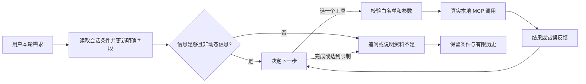

# 港慢游 1.2：LangGraph 会话与工具循环

本地优化完成于 2026-10-19，基于 1.1.0，使用 LangGraph 1.2.16。本次为 Codex 辅助开发；用户亲自运行、理解和改写的部分应另行记录。没有操作课程系统，也没有部署公网应用或更新公开仓库。

2026-10-20 补充：已完成 DeepSeek 真实资料问答及搜索 → 详情 → 成文循环接通检查，见 [接入说明](DeepSeek接入说明.md)。下文验收数字与未联调描述保留为 10 月 19 日的开发快照；不能将该快照中的模拟模型验收改称真实模型评测。

2026-10-23 最新实现：模型模式已改为模型理解历史并提出条件与行程修改，新增更新条件、局部编辑和回顾工具；本地规则解析只在演示模式使用。重命名、模型六轮合成联调与当前边界见 [最新验收记录](evidence/model-conversation/验收说明.md)。下文保留为旧版快照。

## 具体改变

例如先输入“带父母九龙一天，少走路，安排行程”，再输入“改成只选室内”。第二轮沿用九龙、一天和轻松节奏，只更新室内条件。缺少天数时先询问；“必去星光大道”和“只选室内”冲突时提示调整，保留原条件，用户取消室内限制后可以继续。

原问答接口固定调用检索，原规划接口接收完整表单。现在新增 `/api/agent`，在原有四个只读 MCP 工具之外加入决策循环；原接口继续可用。



LangGraph 在这里负责组织步骤和保存每个会话的状态，类似带反馈的状态机：工具输出是下一次决策的输入。硬件状态机的类比只对应“状态、输入和跳转”；模型作出的选择具有不确定性，因此仍需校验和调用上限。

## 两种运行模式

- **无 Key 的本地规则演示**：同样运行真实 LangGraph 和本地 stdio MCP，但由规则选择检索或规划。它能演示会话条件和错误反馈，不能证明模型会自主选工具。
- **主动开启的模型模式**：通过已配置的 HTTPS `/chat/completions` 服务发送工具定义。模型每次选择一个工具，工具结果作为下一条 `tool` 消息回传，再请求下一次选择或结束。已用本地 HTTP 模拟响应检查格式和循环；真实模型尚未联调。

已有模型配置可复用。服务须支持 function calling（模型返回工具名称与参数的接口格式）。在“接着聊”勾选“让模型选择工具”才会调用；切换模式需清除旧会话。开启后，本轮问题、有限历史、条件和工具结果会发给配置的服务。没有新增付费账户或调用真实付费接口。

会话条件目前采用保守中文规则识别：地区、1–3 天、轻松/充实、室内、公共空间和明确的必去地点。兴趣沿用默认值，不支持任意自然语言修改，也不把复杂需求解析包装成已验证能力。“少走路”对应轻松节奏，未核验实际步行或无障碍条件。

## 记忆和资源边界

`InMemorySaver` 是 LangGraph 的内存检查点保存器。每轮结束后只保留一个精简检查点，包含条件、意图和最近 8 条对话消息；工具过程不无限累积。会话最多 32 个，闲置 30 分钟在后续请求时清理。同一会话串行，不同会话相互隔离。

刷新网页会从新会话开始，旧服务端会话随后按闲置期限清理；“清除会话”会立即移除对应内存状态。服务重启即全部清除。没有持久数据库，也没有跨设备账户或长期记忆。请求体传递随机会话凭据，不把它放入地址或保存到浏览器存储。关闭 LangSmith 自动追踪，避免继承环境配置将对话发往追踪服务。

每轮最多 6 次工具尝试、8 次决策，总时限 50 秒，单工具时限 15 秒、单模型 HTTP 时限 12 秒。相同工具与有效参数重复两次后，第三次停止。次数包含被参数校验拒绝的尝试，因此不等于真实 MCP 执行次数；各条成功记录附实际 MCP 通信信息。

## 失败如何处理

工具不存在、参数非法、未检索就读取详情、条件冲突、超时和空结果，会形成结构化反馈，让下一次决策修正或停止。模型不能通过工具参数覆盖记住的地区和室内条件，也不能自动放宽必去约束。模型本身请求失败或输出协议不合格时直接停止；用户可以清除并关闭模型，用本地演示继续。

模型成文必须通过引用编号、引用集合、文本长度等校验；无来源事实、链接、HTML 和命中的动态信息表达会回退为本地结果。检索工具返回的地点还会重新读取本地规范记录，不能靠工具里的文字伪造来源。异常只返回固定提示，不显示原始供应商异常、Key 或请求地址。

这些规则限制工具权限和常见错误，**不证明所有提示注入都被阻挡，也不证明带正确编号的模型陈述必然正确**。动态保护是关键词规则；真实营业、天气、票价和导航仍需核实。

## 验收与证据

先冻结 `docs/evidence/agent-v1/protocol.md`，再实现。新检查均为作者编写的开发验收，不是盲测、独立评测或真实用户研究。

- Python 回归：**135 项通过**，其中新增 Agent 30 项，继承 105 项。
- Node 前端缓存回归：**5 项通过**；新增会话界面另做浏览器实测。
- 原开发检索例题：**22/22**，不能表述为独立准确率。
- 新增 **4 组真实 stdio 场景验收**：多轮条件、冲突后修正、补充天数、模拟模型 search → detail → finish。
- 本地依赖检查、21 条资料验证通过。原检索保留集 SHA256 未变：`01c5e215f9fa3f45b28707fe5ef8c3caa5ea4c42935b426cfdb62c99e043a31b`。本轮没有使用该集调参。

最后新增的混合地点返回测试首次误以为所选场馆中存在符合“九龙、室内、公共空间”的记录，实际无符合者，正确结果为空。保留首次失败记录 `first-filter-fixture-failure.txt`，只修正测试预期，未放宽条件或修改资料。

新增测试还覆盖未知工具、错误参数恢复、空检索重写、超时、重复调用和预算终止、会话隔离/过期/容量/清除、总时限取消、保留有限历史、错误引用和不可信来源。浏览器结果与截图见同目录的 `browser-acceptance.json` 和 `browser.png`。

原固定接口没有会话记忆或模型工具选择；新接口已提供对应机制。这是接口能力变化，尚未测量真实模型的工具选择正确率、任务成功率、延迟收益或费用变化。模拟模型的选择顺序由测试预先规定。费用为 null；不能把它解释为真实模型成本为零。

复核命令：

```sh
python -m pip install -r requirements-lock.txt
python scripts/verify.py --out docs/evidence/agent-v1/regression
python scripts/evaluate_agent.py
python run.py --port 8767
```

Node 不在 PATH 时给 `verify.py` 传 `--node /绝对路径/node`。本轮实际平台为 macOS arm64 / Python 3.14.7；Windows、手机和真实模型/高德没有验收。

关键文件：`travel/agent.py`、`app.py`、`static/app.js`、`tests/test_agent.py`、`scripts/evaluate_agent.py`。完整机器可读证据：`docs/evidence/agent-v1/acceptance.json` 和 `regression/summary.json`。

实现参考：[LangGraph 官方快速开始](https://docs.langchain.com/oss/python/langgraph/quickstart)、[官方状态保存说明](https://docs.langchain.com/oss/python/langgraph/persistence)。本项目使用 StateGraph、条件边和 InMemorySaver，沿用自己已有的 MCP 工具，没有复制完整旅游应用或第三方个人经历。
